<p align="center"></p>

# Candlestick Signal Alerts (MetaTrader 5 and MetaTrader 4)

A free indicator that marks 13 classic candlestick patterns on the chart with an arrow and a short label, **on closed bars
only**, and sends an alert when a new one completes. Source for both editions, a Python reference of the rules, and the
tests that were used to check that the MT5 and MT4 code, the Python reference and each other all agree.

**Website:** [allanninal.dev/mql5 (indicators)](https://www.allanninal.dev/mql5/#indicators) · [MT4 editions](https://www.allanninal.dev/mql5/#mt4) · [allanninal.dev](https://www.allanninal.dev)
· **Contact:** message me on [LinkedIn](https://www.linkedin.com/in/allanninal/).

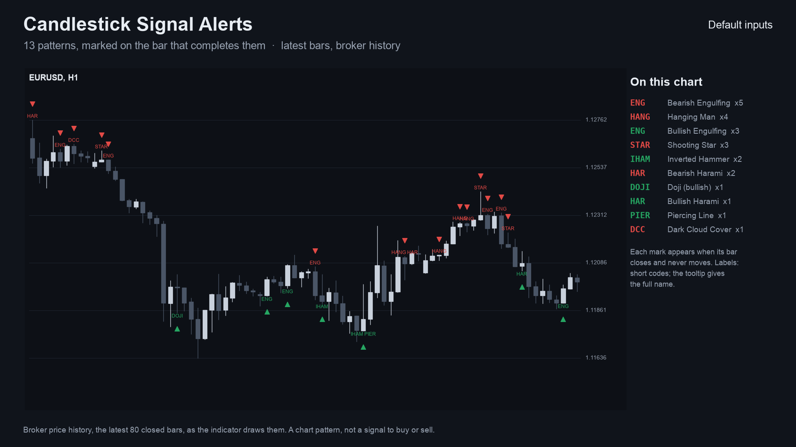

> It is an indicator, not a strategy. It draws marks and places no trades. Nothing here is a profit claim
> (see [Honest limits](#honest-limits)).

## Get it on the MQL5 Market

| Edition | Platform | Price | Link |
|---|---|---|---|
| Candlestick Signal Alerts | MT5 | free | <https://www.mql5.com/en/market/product/201775> |
| Candlestick Signal Alerts MT4 | MT4 | free | <https://www.mql5.com/en/market/product/202358> |
| Candlestick Scanner | MT5 | paid | <https://www.mql5.com/en/market/product/201779> |
| Candlestick Scanner MT4 | MT4 | paid | <https://www.mql5.com/en/market/product/202406> |

The Market builds are the same calculation as the source in this repository. The two scanner editions are a separate,
paid product that is **not** part of this repository (see [Free vs Pro](#free-vs-pro)).

## Contents

1. [What it is and who it is for](#what-it-is-and-who-it-is-for)
2. [Why it was built](#why-it-was-built)
3. [How it works](#how-it-works)
4. [Non-repainting: the proof and how it was tested](#non-repainting-the-proof-and-how-it-was-tested)
5. [Architecture and buffers](#architecture-and-buffers)
6. [Inputs, alerts, install and compile](#inputs-alerts-install-and-compile)
7. [Run the Python reference and the tests](#run-the-python-reference-and-the-tests)
8. [Honest limits](#honest-limits)
9. [Free vs Pro](#free-vs-pro)
10. [Licence](#licence)

## What it is and who it is for

**What:** 13 textbook candlestick patterns found by fixed numeric rules. Each pattern gets an arrow (green up for a
bullish pattern, red down for a bearish one) and a short label (`ENG`, `HAM`, `HANG`, `IHAM`, `STAR`, `DOJI`, `MSTAR`,
`ESTAR`, `HAR`, `PIER`, `DCC`) on the bar that **completes** it. Point at a label to read the full name. Alerts: pop-up
(on by default), sound, push notification, e-mail.

**For:** traders who read candles and want the patterns found for them, with a definition they can read. Also for
developers who want a small, tested pattern engine with documented buffers to read from an EA with `iCustom`.

**Not for:** anyone who expects a pattern to predict direction. A pattern describes the shape of one to three bars.

| | |
|---|---|
| 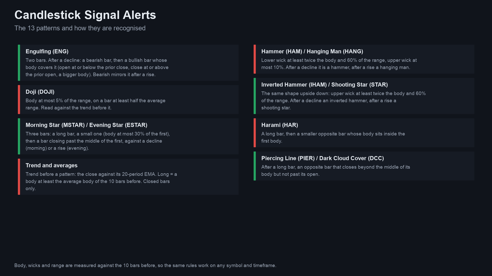 | 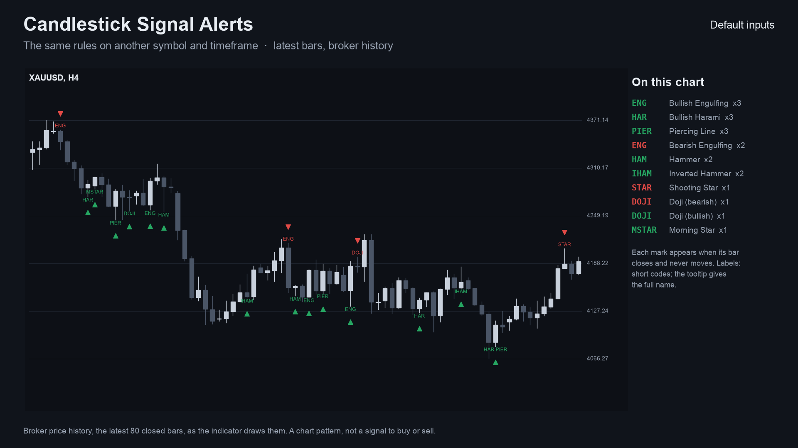 |
| 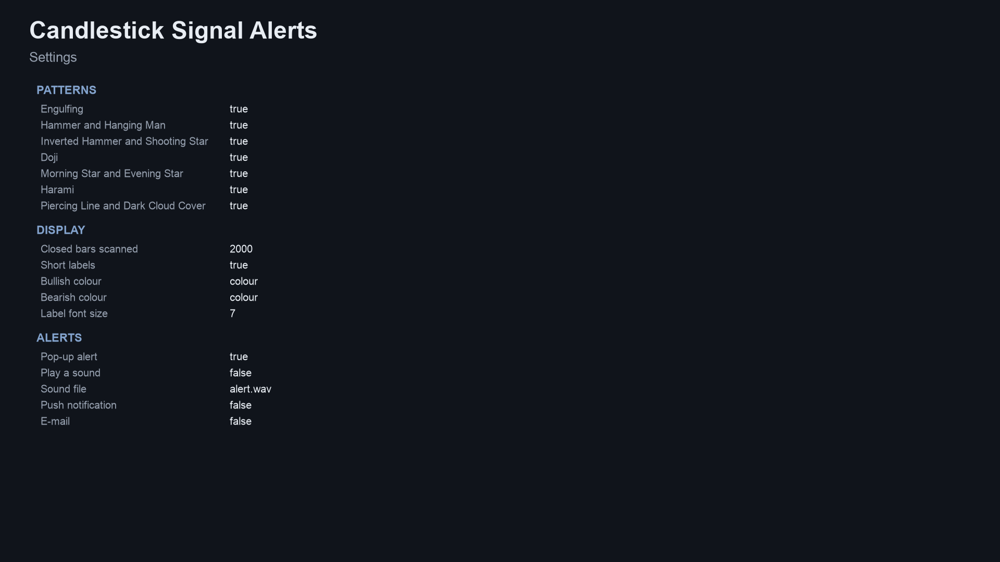 | |

Image notes: the charts are drawn by the Python reference on broker price history (the same marks the indicator shows);
the rules and settings sheets are illustrations, not terminal captures. MT4 versions are in
[`docs/images/mt4/`](docs/images/mt4).

## Why it was built

Candlestick patterns are the most-read chart method there is, and the market for them is crowded. The motivations, stated
with the evidence we actually have:

- **A readable definition.** Many pattern indicators are closed boxes whose rules cannot be checked. Here every rule is a
  line of arithmetic in [`tests/reference.py`](tests/reference.py) and in the `.mqh` engine.
- **Trust in the marks.** A mark is only drawn on a bar that has closed and never moves afterwards. Our market research
  (demand scan of MQL5 Market, forums, freelance boards and book and course audiences, October 2026) found repeated
  complaints about indicators that repaint.
- **Honest scale of demand.** The same research counted roughly 170 candlestick-pattern indicators on the MQL5 Market
  (about 54 of them free) and the largest dedicated reading audience of any method, but concluded that patterns alone
  are a crowded, low-differentiation product. This is a free tool with a clean, tested reference implementation, not a
  claim of unmet demand.
- **Provable behaviour.** Every number in this README comes from an executed check, listed below.

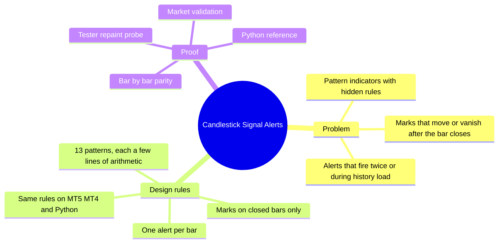

## How it works

### The measures, step by step

Let `O, H, L, C` be a bar's open, high, low, close and `k` the bar being decided (the bar that just closed). Bars are
numbered oldest first.

| Measure | Formula |
|---|---|
| body | `|C - O|` |
| range | `H - L` |
| upper wick | `H - max(O, C)` |
| lower wick | `min(O, C) - L` |
| average body, average range | simple average of the body / range of the **10 bars before** `k` (`k-10 ... k-1`) |
| trend at bar `j` | `+1` if `C[j] > EMA20[j]`, `-1` if below, `0` otherwise. `EMA20` is seeded with the average of the first 20 closes, then `EMA[i] = EMA[i-1] + 2/21 * (C[i] - EMA[i-1])` |
| tie tolerance | comparisons treat values within `1e-9 x price` as equal (see [the tie lesson](#the-tie-lesson)) |

A bar is *bullish* if `C > O`, *bearish* if `C < O`. Nothing is decided before bar 10 (the averages) or bar 3.

### The 13 patterns

`b` = body of `k`, `r` = range of `k`, `u` / `w` = upper / lower wick of `k`, `p = k-1`, `q = k-2`, `ab` = average body,
`ar` = average range, `t1, t2, t3` = trend at `k-1, k-2, k-3`.

| # | Pattern | Direction | Rule (all conditions) |
|---|---|---|---|
| 0 | Bullish Engulfing | + | `p` bearish, `k` bullish, `O[k] <= C[p]`, `C[k] >= O[p]`, `b > body[p]`, `t2 < 0` |
| 1 | Bearish Engulfing | - | mirror: `p` bullish, `k` bearish, `O[k] >= C[p]`, `C[k] <= O[p]`, `b > body[p]`, `t2 > 0` |
| 2 | Hammer | + | `w >= 2b`, `u <= 0.1r`, `w >= 0.6r`, `r > 0`, `t1 < 0` |
| 3 | Hanging Man | - | the same shape, `t1 > 0` |
| 4 | Inverted Hammer | + | `u >= 2b`, `w <= 0.1r`, `u >= 0.6r`, `r > 0`, `t1 < 0` |
| 5 | Shooting Star | - | the same shape, `t1 > 0` |
| 6 | Doji | `-t1` | `b <= 0.05r`, `r >= 0.5 ar`, `r > 0`, `t1 != 0` (direction is against the trend before it) |
| 7 | Morning Star | + | `q` bearish with `body[q] >= ab`; `body[p] <= 0.3 body[q]`; `min(O[p], C[p]) <= C[q]`; `k` bullish and `C[k] > (O[q]+C[q])/2`; `t3 < 0` |
| 8 | Evening Star | - | mirror: `q` bullish, `max(O[p], C[p]) >= C[q]`, `k` bearish, `C[k] < (O[q]+C[q])/2`, `t3 > 0` |
| 9 | Bullish Harami | + | `p` bearish with `body[p] >= ab`, `k` bullish, `O[k] >= C[p]`, `C[k] <= O[p]`, `b < body[p]`, `t2 < 0` |
| 10 | Bearish Harami | - | mirror: `p` bullish, `k` bearish, `O[k] <= C[p]`, `C[k] >= O[p]`, `b < body[p]`, `t2 > 0` |
| 11 | Piercing Line | + | `p` bearish with `body[p] >= ab`, `k` bullish, `O[k] <= C[p]`, `(O[p]+C[p])/2 < C[k] < O[p]`, `t2 < 0` |
| 12 | Dark Cloud Cover | - | mirror: `p` bullish, `k` bearish, `O[k] >= C[p]`, `O[p] < C[k] < (O[p]+C[p])/2`, `t2 > 0` |

The inputs group the 13 into seven switches (engulfing, hammer and hanging man, inverted hammer and shooting star, doji,
stars, harami, piercing and dark cloud). Several patterns can complete on the same bar; the label then lists each.

### Per-bar algorithm

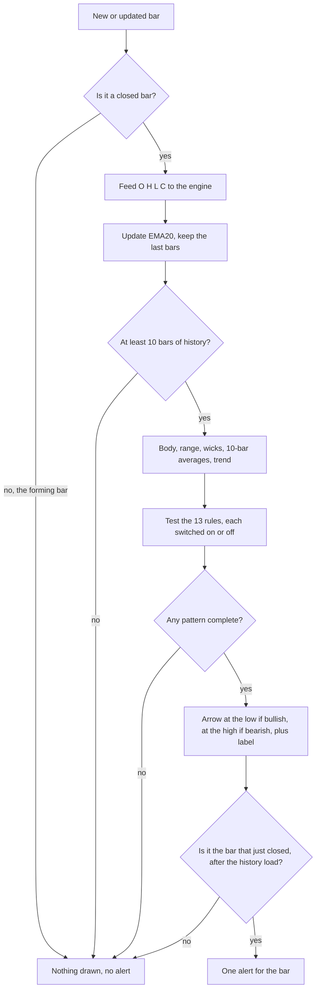

### Signal states

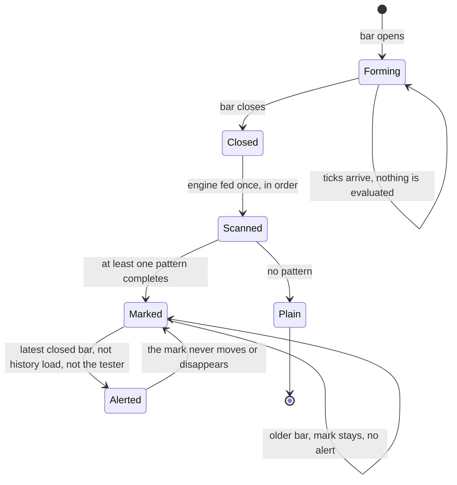

### Alert flow

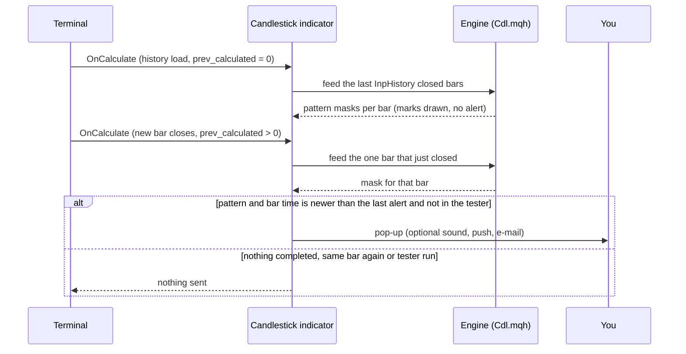

### How often patterns appear (measured)

Pattern marks per 1,000 closed H1 bars, default inputs, on broker history of EURUSD, GBPJPY, XAUUSD and BTCUSD (375,988
bars in total, up to 100,000 per symbol). The engine's default `InpHistory` is 2,000 bars; this count scans every bar
with the Python reference. It counts marks only. It says nothing about what price does afterwards. Source:
[`docs/data/pattern-frequency.json`](docs/data/pattern-frequency.json), made by [`tests/frequency.py`](tests/frequency.py).

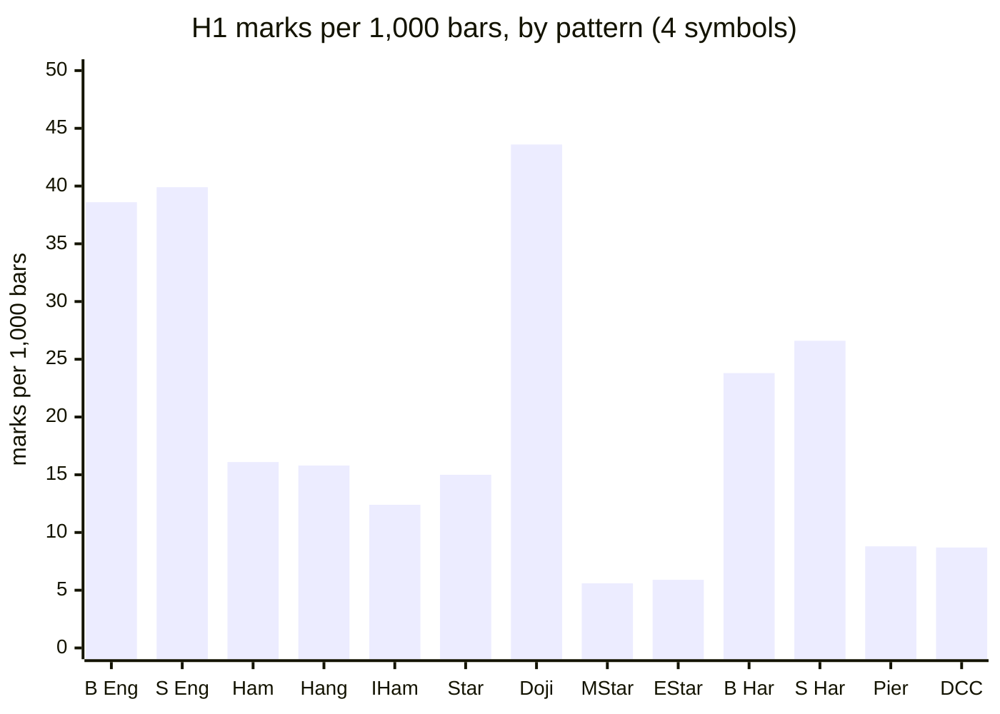

All 13 together: 260.7 marks per 1,000 bars, so roughly one closed bar in four carries a mark. Common patterns (doji,
engulfing) appear often; the three-bar stars are rare. This is why the arrows are best used as context, not as entries.

### The tie lesson

Rule thresholds sit on derived values (`2 x body`, `0.05 x range`, a midpoint). On five-digit prices, exact decimal ties
happen, for example a wick that is exactly twice the body. MT5 and Python rounded those ties differently and disagreed
on 73 bars until both engines were changed to compare with a tolerance of `1e-9 x price`. The same tolerance is in
`Cdl.mqh` (`GE`, `LE`, `GT`, `LT`) and in `tests/reference.py`. Any ratio-threshold engine needs it.

## Non-repainting: the proof and how it was tested

"Non-repainting" is easy to claim. Here is what was actually run. Raw result files are in [`tests/results/`](tests/results).

**1. Implementations compared bar by bar.** The Python reference ([`tests/reference.py`](tests/reference.py)) holds the rules; it was written first and the MQL engines were compared with it. The MT5 and MT4 indicators were dumped bar by bar (every buffer) in the MetaTrader Strategy Tester (MT4) or by a script (MT5), and [`tests/check_parity.py`](tests/check_parity.py) compared each dump with the reference: pattern marks must be identical on every closed bar.

Run on this exact code: compile 0 errors, 0 warnings (both editions); MT5 24 dumps and MT4 25 dumps (EURUSD, GBPJPY, XAUUSD, BTCUSD on M15, H1 and H4 with the repository's input sets; MT4 adds an every-tick run on EURUSD H1), all identical to the reference on every closed bar; the repaint probes found 0 closed bars that changed afterwards.

**The wider matrix**, made with the Market builds before this repository was cut from them (the same calculation; four symbols EURUSD, GBPJPY, XAUUSD, BTCUSD, M15, H1 and H4, the repository's input sets), checked here against the same reference:

| | MT5 | MT4 |
|---|---|---|
| dumps compared | 24 | 25 |
| bars compared | 1,059,555 | 624,737 |
| failures | 0 | 0 |
| result | ALL PASS | ALL PASS |

Sources: [`tests/results/parity-wide-run-mt5.txt`](tests/results/parity-wide-run-mt5.txt), [`tests/results/parity-wide-run-mt4.txt`](tests/results/parity-wide-run-mt4.txt). MT5 history starts later than MT4's test history on some pairs, which is why the bar counts differ.

**2. Repaint probe.** An EA records which signal buffers are set on each bar *at the moment it closes*, then reads the same bars again at the end and counts any value that changed. It also counts any signal ever shown on the still-forming bar.

| Run | Closed bars checked | Signals seen at close | Changed afterwards | Signals on the live bar |
|---|---|---|---|---|
| MT5, Market build, EURUSD H1, every tick, 10,411,052 ticks | 4,644 | 1,114 | **0** | **0** |
| MT4, Market build, 25 runs combined | 506,172 | 114,492 | **0** | **0** |

Source: [`tests/results/repaint-summary.md`](tests/results/repaint-summary.md). The MT5 probe was run once per build on one symbol and timeframe; the MT4 probe ran on every dump run.

**3. Market validation.** Both Market builds passed the MQL5 Market's automated product validation before publication (this is the Market's own check, not part of this repository).

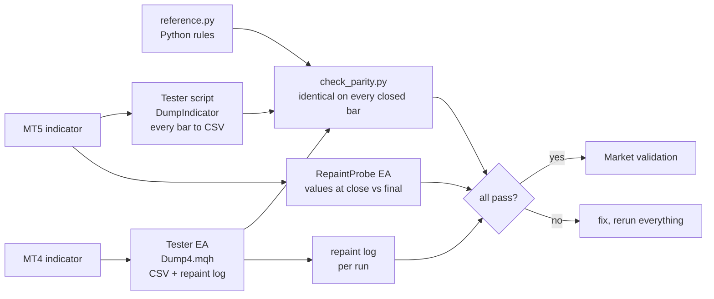


### Why the design cannot repaint

- The engine is fed only bars up to `rates_total - 2`, i.e. never the forming bar, so a mark is created only after its
  bar has closed.
- Each decision uses that bar and earlier bars only (no look-ahead): the pattern's own bars, the 10 bars before, and the
  EMA, which is a recursive formula.
- Alerts fire only for the bar that just closed, only after the history load, once per bar, and never in the tester.

## Architecture and buffers

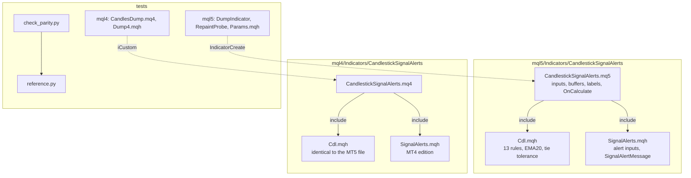

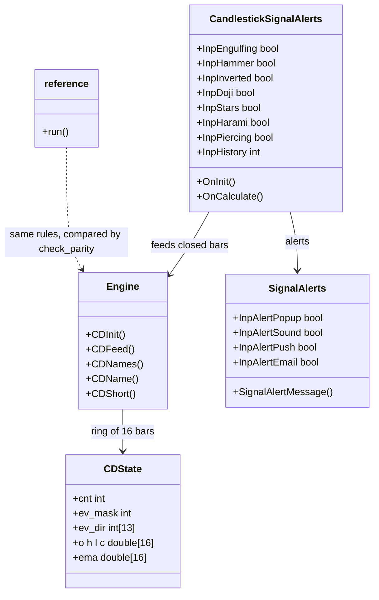

### `iCustom` buffer table (for EA developers)

| Buffer | MT5 | MT4 |
|---|---|---|
| 0 | **Bullish** arrow price (bar low on MT5, below it on MT4), empty otherwise | same |
| 1 | **Bearish** arrow price (bar high on MT5, above it on MT4), empty otherwise | same |
| 2 | bit mask of the bullish patterns on the bar (bit `n` = pattern `n` of the table above) | same |
| 3 | bit mask of the bearish patterns on the bar | same |

Empty value is `EMPTY_VALUE`. Read marks on **closed bars** (shift 1 and higher). The `InpHistory` setting limits how far
back marks are drawn. `iCustom` parameters follow the input order: seven pattern switches, history, labels, bullish
colour, bearish colour, font size, (MT4 only: arrow gap), pop-up, sound, sound file, push, e-mail. In MT5 the `input group`
headings also count as string parameters when you build a handle with `IndicatorCreate` (see
`tests/mql5/Include/IndTest/Params.mqh` and the strings in `tests/check_parity.py`).

## Inputs, alerts, install and compile

| Input | Default | Meaning |
|---|---|---|
| Engulfing, Hammer and Hanging Man, Inverted Hammer and Shooting Star, Doji, Morning/Evening Star, Harami, Piercing and Dark Cloud | all on | Switch a group of patterns on or off |
| Closed bars to scan on the chart | 2000 (100-20000) | How far back marks are drawn |
| Short labels | true | Show the label text next to each arrow |
| Bullish colour, Bearish colour, Label font size | green, red, 7 | Look only |
| Arrow distance from the candle (MT4 only) | 0.5 x ATR(14) | MT4 cannot shift arrows by pixels |
| Pop-up alert | true | Terminal alert window |
| Play a sound / sound file | false / alert.wav | File from the terminal's Sounds folder |
| Push notification | false | Needs your MetaQuotes ID in Options |
| E-mail | false | Needs e-mail set up in Options |

**Install from source.** Copy `mql5/Indicators/CandlestickSignalAlerts/` into `<terminal data folder>/MQL5/Indicators/` (MT5) or
`mql4/Indicators/CandlestickSignalAlerts/` into `<data folder>/MQL4/Indicators/` (MT4), open the `.mq5` or `.mq4` in
MetaEditor and press Compile (F7). Both compile with 0 errors and 0 warnings (checked on a Windows machine with MetaEditor, from a clean scratch folder that holds only these files; the compiled files are not in
the repository). Keep the three files of each edition together: the indicator includes `Cdl.mqh` and `SignalAlerts.mqh`
from its own folder.

## Run the Python reference and the tests

```bash
python3 -m venv .venv && . .venv/bin/activate && pip install -r requirements.txt
```

```python
import sys; sys.path.insert(0, "tests")
from reference import run, NAMES
# o, h, l, c are float lists of OHLC bars, oldest first
rows = run(o, h, l, c)          # rows[k]["ev"] = [(pattern index, direction), ...], rows[k]["mask"] = bit mask
```

To repeat the parity check on your own data:

1. Compile the indicator and the test tool for your platform (`tests/mql5/Scripts/DumpIndicator`, or
   `tests/mql4/CandlesDump.mq4` with `tests/mql4/Include/IndTest4/Dump4.mqh` in your `MQL4/Include/IndTest4/`; MT5 also
   needs `tests/mql5/Include/IndTest/Params.mqh`).
2. Run it in the Strategy Tester (MT4) or as a script (MT5) for each symbol and timeframe, with the input sets in
   `tests/configs.tsv` (MT5; the exact `InpParams` strings are in `tests/check_parity.py`) and `tests/mql4/configs.tsv`
   (MT4). The tool writes one CSV per symbol and timeframe into a `dump` folder.
3. `python3 tests/check_parity.py <folder that contains dump>` (add `--mt4` for MT4 dumps). It prints PASS or FAIL per
   file and an overall result.
4. Repaint: run `tests/mql5/Experts/RepaintProbe` in the MT5 Strategy Tester (every tick); the MT4 test EA writes its
   repaint log with the dump.

The price dumps used for the published numbers are not in this repository (they are broker price data).

## Honest limits

- **A pattern is not a strategy.** No stop-loss, position sizing or exit rules are provided or implied, and the rules
  were not optimised or back-tested for profit. In the author's own check of how price moved after these patterns, the
  moves were close to what follows any bar: no edge is claimed anywhere.
- **No profit or accuracy claim is made.** The only numbers here are about *consistency* (the implementations agree,
  marks do not move) and *frequency* (marks per 1,000 bars).
- **The definitions are one reading.** Candlestick names have several textbook definitions. These are the thresholds
  above (for example a hammer's lower wick of at least twice the body); other tools differ, so counts will differ.
- **The trend test is simple.** "Trend before" is the close against its 20-period EMA, not a swing analysis.
- **Frequent marks.** About one closed bar in four carries a mark at default settings. Switch groups off to cut noise.
- **Scope of the tests.** Four symbols on M15, H1 and H4 for the Market builds (the same calculation), the repository's input sets, one MT5 repaint run; the code in this repository has so far been compile-checked only, and the MT5 build was not run on a live chart as part of these numbers. Other symbols and timeframes are not covered by the published numbers.
- A multi-symbol scanner that watches patterns across many symbols exists as a separate paid product (see below).

## Free vs Pro

| | Free: Candlestick Signal Alerts | Paid: Candlestick Scanner |
|---|---|---|
| Platforms | MT5 [201775](https://www.mql5.com/en/market/product/201775), MT4 [202358](https://www.mql5.com/en/market/product/202358) | MT5 [201779](https://www.mql5.com/en/market/product/201779), MT4 [202406](https://www.mql5.com/en/market/product/202406) |
| Price | free | paid (see the Market page) |
| What you get | 13 patterns with arrows, labels and alerts on the current chart, source here | A multi-symbol, multi-timeframe scanner, as described on its Market listing |
| Source | this repository | not published |
| Closed-bar marks, no repaint | yes | see its listing |

No need to buy the paid product to use the free one: the free indicator is complete on its own.
Website: [allanninal.dev/mql5](https://www.allanninal.dev/mql5/#indicators) ([MT4](https://www.allanninal.dev/mql5/#mt4)).

## Licence

Copyright 2026 Allan Niñal (<https://www.allanninal.dev/mql5>). Licensed under the
[PolyForm Noncommercial License 1.0.0](LICENSES/PolyForm-Noncommercial-1.0.0.md): source-available, free for personal
and other noncommercial use, not for commercial use. Each source file has an `SPDX-License-Identifier` line. Text:
[`LICENSE`](LICENSE). The candlestick patterns are textbook definitions; the code is original. The licence applies to this
source, not to anything you build or trade with the indicator. Trading involves risk; the software is provided as is.

---

**Website:** [allanninal.dev/mql5](https://www.allanninal.dev/mql5/#indicators) · [MT4](https://www.allanninal.dev/mql5/#mt4) · [allanninal.dev](https://www.allanninal.dev)
· Questions: message me on [LinkedIn](https://www.linkedin.com/in/allanninal/).
